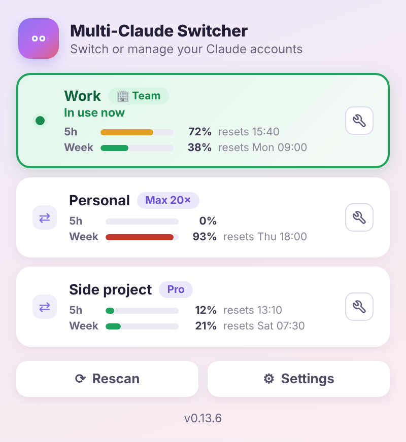

# Multi-Claude Switcher


在同一台电脑上切换多个 Claude Desktop 账号。免退出登录、免重打密码，每个账号的 Claude Code 对话记录各自保留。

[](https://github.com/miou1107/multi-claude-switcher/releases/latest)
[](LICENSE)
&nbsp; [English](README.md) | **简体中文**

---

## 为什么你需要这个工具？

通常 Claude Desktop 一次只支持使用一个账号，所以在这两种情况下你会特别痛：

- **额度用尽**：A 账号额度用完了，想换 B 账号继续写 Code。
- **公私分明**：公司的项目和自己个人 Side Project，不想全部都混在同一个账号中。

如果要手动切换账号的话，你得要先退出登录再重新登录另一组账号，而且等它跑完后会发现 **侧边对话记录空了**，
因为那些记录是跟着上一个账号走的。

**这个工具就是来解决这件事的：**

1. **一键秒切**：点系统托盘的常驻图标可秒切多账号。
2. **永远登录**：每个账号都各自保持登录状态，切换时完全不用重新输入账号密码。
3. **记录不打架**：各账号的 Code 对话记录原封不动、互不干扰。单纯切换完全不会
   动到任何 session 数据。
4. **跨账号对话记录同步**：当然你也可以勾选自动同步(或手动同步)，让所有账号的对话记录保持一致，方便你跨账号开发。


---

## 安装

> ⚠️ **Windows用户重要提醒**
> 你必须使用**独立安装版**的 [Claude Desktop](https://claude.com/download)。
> **Microsoft Store 版不支持**：如果你是从 Microsoft Store 安装 Claude Code，可能会因其沙盒限制而无法正常使用。
>  建议你从 Claude 下载官方 .exe 独立安装版。

**macOS**
> macOS用户推荐使用 brew 命令安装，快速又方便!
```bash
brew install --cask miou1107/tap/multi-claude-switcher
```

或是到[最新版本](https://github.com/miou1107/multi-claude-switcher/releases/latest)
下载 `Multi-Claude-Switcher_<版本>_macos.zip`，解压缩后把
**Multi-Claude Switcher.app** 拖进**应用程序**。

*只有第一次要做。* 目前 app 没有Apple Developer 公证签章，所以安装时可能会被挡。
请打开macOS的**系统设置 → 隐私与安全性**往下滚动，点**仍要打开**就能完成安装并正常使用。

或者可以直接用终端命令解除限制，就能正常安装使用：

```bash
xattr -dr com.apple.quarantine "/Applications/Multi-Claude Switcher.app"
```

**Windows**

到[最新版本](https://github.com/miou1107/multi-claude-switcher/releases/latest)
下载 `Multi-Claude-Switcher_<版本>_windows_setup.exe` 运行。它只装给你这个用户，
所以不会弹出管理员权限提示。装完从**开始菜单**开 **Multi-Claude Switcher**。


**自动更新**

完成安装后，只要有新版发布，系统便会自动在后台更新到最新版本。更新时不会问你，装好之后会弹出一条通知。自己按「检查更新」的话，一定会有回应：已经是最新版会直接告诉你，有新版就马上更新。

## 怎么用

安装完成后，请在 macOS 菜单栏或 Windows 系统托盘上找到眼睛图标，
点击后功能面板就会弹出来。每个画面的右上角都有一个 ×，按下去就能关掉面板，按 Esc 也可以。

面板上会显示你的账号列表，并标出你现在在用哪个。可随时切换到不同账号，切换后 Claude Desktop
会自动重开至你指定的账号。切换进行中，面板会在原本确认框的位置显示一张进度卡，让你知道系统正在跑，
而不是怀疑刚刚那下有没有按到。切好了它会告诉你现在在哪个账号；万一切换失败，它会直接说失败原因。
同步、合并、备份也是同一张卡片，而且卡片还在的时候面板不会自己关掉。

**Rescan** 会找出这台电脑上曾经登录过的账号，你可以自行勾选并加入账号列表中。**Change name（改名）**
和 **Remove from list（从列表移除）** 都藏在账号列上的扳手按钮里：点一下，一个小菜单就会直接
在那一列上打开，不会跳到另一个画面。

**Change name** 一按下去，那一列本身就会变成一个可以打字的字段，就地修改。按 Enter 保存，按 Esc
取消。

**Remove from list** 一样会打开原本那个确认画面。按下去会把这个账号从列表上拿掉，做法是把它的配置文件夹
归档起来，不会删除，你随时都可以到 Settings 打开这个归档文件夹。之后要再用这个账号，只要重新
登录一次就好。如果列表上只剩一个账号，菜单里就不会出现 Remove from list 这一项。如果 Claude 现在正开着
这个账号，菜单里还是有 Remove from list，只是选下去会告诉你要先切到别的账号，所以你要移除的是「另一个」
账号时，完全不需要先关掉 Claude。在 Microsoft Store 版上，还会拒绝移除：目前占用那唯一
共用槽位的账号、MCS 还没扫描过槽位状态的安装，以及对话还在排队要搬进刚加入之新账号的那个账号。
顺利移除完会直接回到账号列表，上面用一行字告诉你完成了；移除失败，或是移除成功但留下了没清干净
的东西，才会另外看到一个说明原因的画面。

**Settings** 里有自动同步对话记录及开机自启动两个开关，一个 **More** 子菜单
（账号之间同步、手动备份、备份文件夹、归档文件夹），以及退出程序。
最下面那行版本号旁边可以检查更新和报告问题，点版本号可以看每一版改了什么。

按 **Esc** 或点面板外面就关掉。Windows 上再点一次系统托盘图标也会关，对图标按右键有
**Quit**，万一面板本身开不起来，那是你的逃生门。

## 额度查询

每个已登录的账号下面都会显示 **5 小时额度**和**每周额度**用了多少，以及各自什么时候重置。
用到 70% 时进度条变黄，90% 时变红，切换之前就能看出哪个账号还有余量。

这些数字来自 Anthropic，和 Claude Code 里 `/usage` 读的是同一个地方。面板会先把账号列表画出来，
稍后再把额度条补上；每次打开面板都会刷新，最多一分钟一次。

读取方式：每个账号的配置文件夹里本来就存着 Claude Desktop 用的登录 token。切换器在本地把它解密，
只发给签发它的 `api.anthropic.com`。它从不续期这个 token，因为续期会让 Claude Desktop 掉登录。
所以一个很久没打开的账号可能会显示 *Open this account in Claude once to refresh its usage*
（在 Claude 里打开一次这个账号就能刷新）；在那之前它会继续显示上一次的读数，已经过了重置时间的额度显示为 0%。

- **macOS** 第一次会询问是否允许 Multi-Claude Switcher 使用钥匙串里的「Claude Safe Storage」，
  Claude 用它保管登录信息的密钥。请选**始终允许**。因为 app 没有经过 Apple 公证，更新后可能会再问一次。
- **Windows** 不会弹出提示：密钥受你的 Windows 账户保护。

读数只有百分比和时间，缓存在 `~/.multi-claude-switcher/usage.json`。想在终端里查看，可以运行 `mcs usage`。

## 把对话搬到另一个账号

切换账号和对话记录同步是两个不同的功能。**单纯切换完全不会动到 session 数据。** 如果你只是要在账号之间
跳来跳去，不需要让对话记录在两个账号间同步，那这一段可以直接跳过。

真的想让对话跟着你走的话，有两条路：

**Sync sessions** 是把一个账号的 Code session 复制到另一个，但不改变你现在用的是哪个
账号。它会先备份目标端，弄完再把你原本在用的账号开回来。

**切换时自动同步**默认是关的。打开之后，每次切换都会把两边的 session 双向合并，久了
两个账号的记录就会一致。第一次打开会警告你一次，因为合并过去的东西，不会因为你把开关
关掉就退回来。

不管走哪条，只要两边都有同一笔对话而状态不同，会保留较晚被更新的那份，另一份会报告给你，
而不是默默丢掉。而且每次写入前都会先做一份带时间戳的快照；快照失败的话，这次写入就直接
不做。

同步的只有 Code 标签页，而且只有对话**列表**。一般聊天的对话存在 Anthropic 服务器上、每个
账号各一份，在本地做什么都搬不动它。而 Code 的对话内容又存在另一个地方，Claude Code 会依
它自己的保留期自动清掉旧的，所以列表上可能有一笔对话、点进去却没有内容了。那是 Claude
自己的例行整理，这个工具既不会造成它、也没办法把它救回来。

## Team 账号和其他账号一样可以同步

这份文档之前写「Team 账号的对话只能导出、不能导入」。那是错的，而且错在这个工具本身。

对话在硬盘上是按「账号」和「组织」两层归档的。同步时只把账号那层换成目标账号，组织那层
还留着来源账号的组织，等于文件完整地放进了目标账号永远不会去读的那一格。看起来就跟
「Team 账号拒绝导入」一模一样，当初也就这样误判了。

现在两层都会换，所以导入 Team 账号的对话会落在该账号真的会读的位置。Team 账号不需要任何
特殊处理，同步前那些针对 Team 账号的警告也一并移除了。

[想看修正前后分别实测了什么 →](docs/team-accounts.md)

## 报告问题

Settings 最下面的 **Report a bug** 会列出这个切换工具知道的机器信息：版本号、每个账号在硬盘上
长什么样子、还有每个 log 文件最后的内容。按 **Report a problem** 会把这份报告复制到
剪贴板，并打开一个预先填好的 GitHub issue 页面让你粘贴进去。

没有任何东西会自动送出。你会先看到完整报告，粘贴、提交都是你自己的账号动手做的。
Email、账号 ID、你的用户名和主目录路径，在报告显示出来之前就已经换成像
`account-1`、`org-A` 这样的代称，彼此的对应关系还看得出来，但真正的值不会离开你的电脑。
换完代称之后还会再跑一次按格式特征查漏的检查，把任何看起来像 email 或账号 ID、却没被
换掉的东西直接涂黑，避免漏掉没登记到的字段。Issue 是公开的。

## 常见问题与救援

**Q：列表上为什么只看到一个账号？**
打开面板点 **Rescan**，勾选你要管理的账号。还没登录过的账号也会列出来：先勾选它，
切换过去，再在 Claude Desktop 里完成登录。

**Q：Rescan 出现「Signed out in Claude Desktop」而且勾不动？**
那个账号是在 Claude Desktop 里退出登录的，这会盖掉该文件夹唯一的一组登录数据。它的对话
其实都还在硬盘上。点 **Recover**，替它取个名字，在跳出来的 Claude 窗口里登录一次就好，
对话会自己跟回来。

要避免这种状况，加账号请用面板里的 **＋ Add another account**，不要在 Claude Desktop
里退出登录。这样每个账号一开始就有自己独立的配置文件。

**Q：（Windows）切过去、登录之后，怎么又回到另一个账号？**
请更新到最新版。用 Google 登录时，浏览器会用一个链接把结果交回 Claude。
Windows 默认会把这个链接交给你的默认账号，除非切换器先把它转交给别的账号。
旧版只为「从来没登录过」的账号转交，所以被要求重新登录的账号没被转交过去。

**Q：（Windows）面板打不开怎么办？**
通常是你的电脑缺了 WebView2 组件。对系统托盘的眼睛图标按右键选 **Quit**，请自行安装好 WebView2 之后再重开 (理论上 Win10 21H2 版本都有内置)。

**Q：我的对话记录乱掉了，救得回来吗？**
可以。Settings → **Open backup folder**，里面是按配置文件分开、带时间戳的快照。
里面还会有一个 `tidied-` 开头的文件夹，放的是旧版本存错位置、任何账号都打不开的对话。
每个账号保留最近五份快照，更旧的会移到旁边的 `.trash` 文件夹，放满 30 天才真正删除，
所以有一个月的时间可以把东西拿回来。你自己放进那个文件夹的东西不会被动到。

**Q：log 在哪里？**
在 `~/.multi-claude-switcher/logs/`。每个 log 的最后几行也会一起放进 bug report，
通常那样就够了。

**Q：如何彻底移除？**

- **macOS**：删掉 app，再清掉 `~/.multi-claude-switcher/` 和
  `~/Library/LaunchAgents/com.miou1107.multi-claude-switcher.plist`。
- **Windows**：从「设置 → 应用」卸载，再删掉 `%USERPROFILE%\.multi-claude-switcher`。

移除本工具完全不会影响你原本的 Claude Desktop 账号与数据。

---

## 参与开发与许可证

[从源代码构建 →](docs/building.md) ·
[CLI 参考 →](docs/cli.md) ·
[工作原理 →](docs/how-it-works.md)

`FILELIST.md` 说明仓库里的每个文件，`CHANGELOG.md` 是版本记录。

许可证：[MIT](LICENSE)。

**免责声明**：本项目与 Anthropic 无任何隶属关系。工具的工作原理只是让 Claude Desktop
对着不同的本地数据目录启动，并在它们之间复制 session 文件；它不会碰到你的登录凭证，
更不会上传任何东西。
请自行判断、斟酌使用本项目代码，作者不提供任何承诺与保障，任何风险及后果由用户自行承担。
